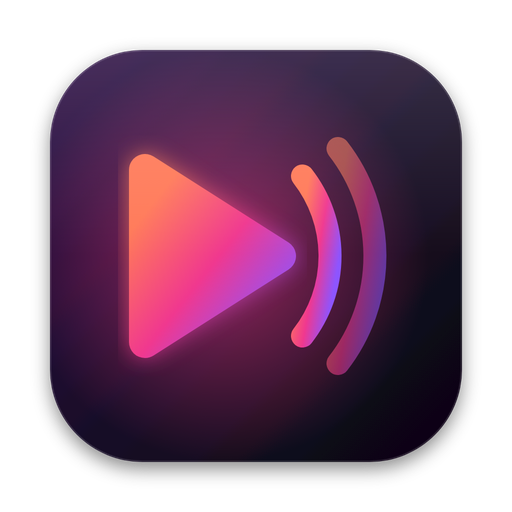
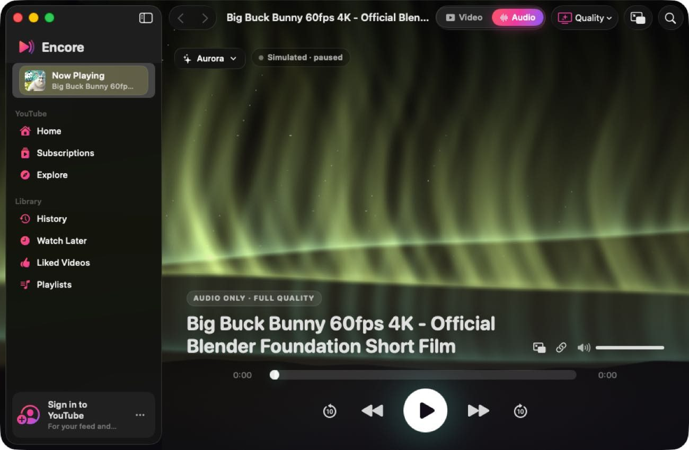
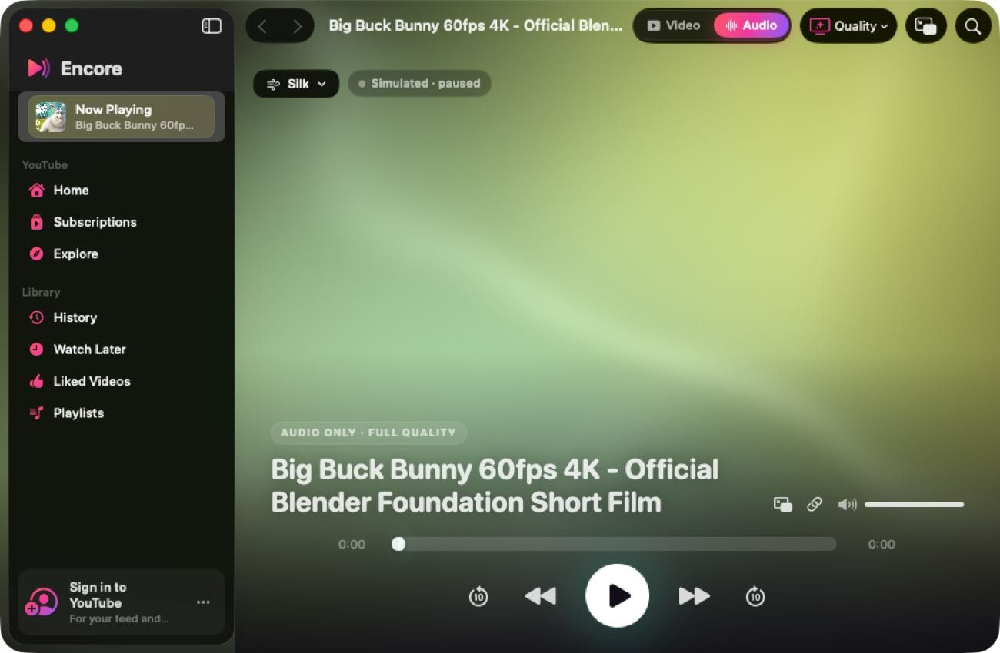
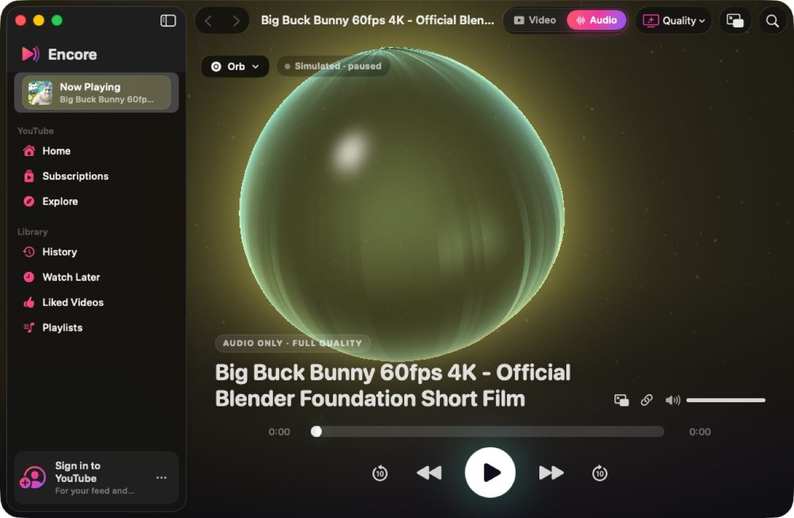
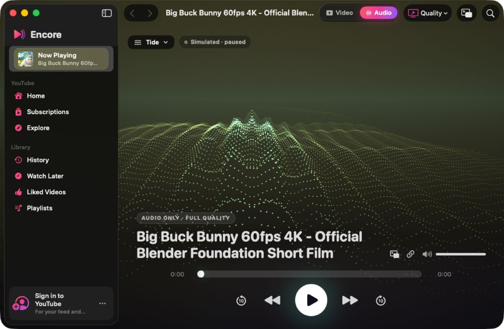
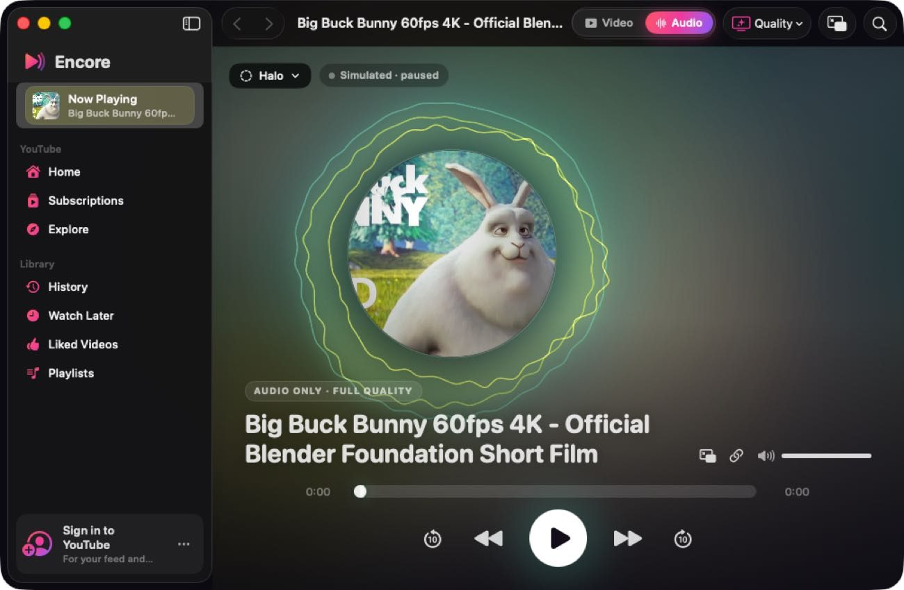
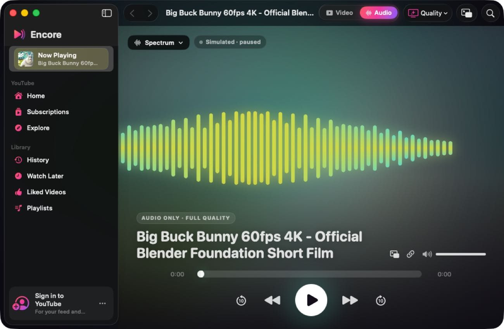
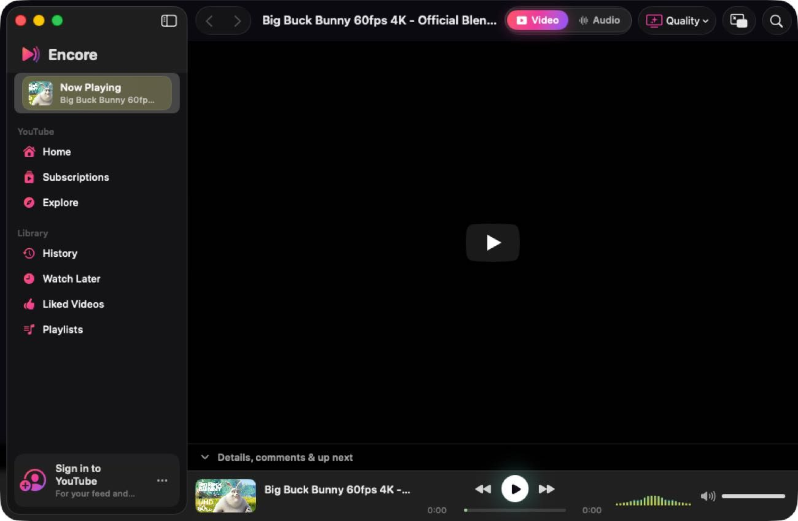
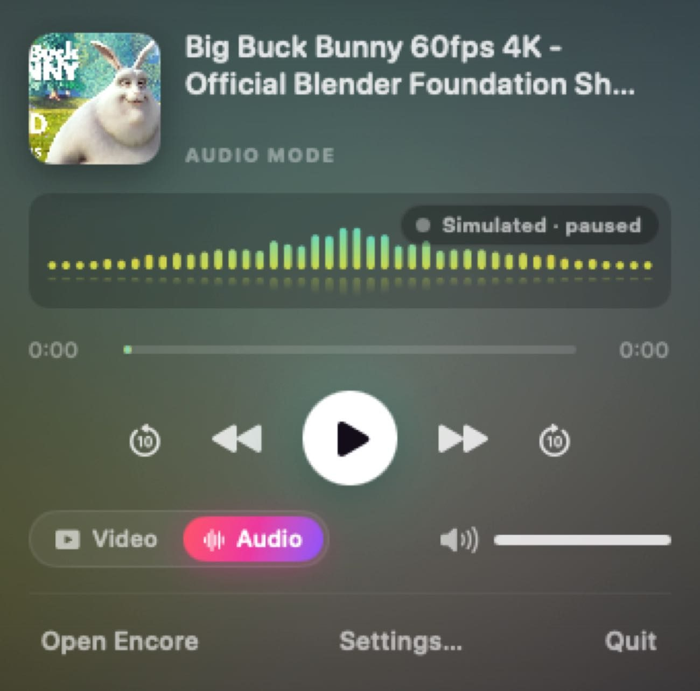

<p align="center"></p>

<h1 align="center">Encore</h1>
<p align="center"><b>A native YouTube player for macOS.</b><br>
Media keys always work, even with every window closed. Video and audio modes at the highest quality YouTube offers, eight calm visualisers that move with the music, a menu bar player and a floating mini player.</p>

---

<p align="center">
  
  
  
  
</p>
<p align="center">
  
  
  
</p>
<p align="center"></p>
<p align="center"><sub>Real captures of Encore on macOS 26. They were taken by the CI smoke test on a small virtual display, with the visualisers in demo mode, because YouTube won't stream to datacenter machines. Colours come from the video's artwork.</sub></p>

## Why Encore exists

If you play YouTube in Safari, pause with the ⏯ key and press it again later, macOS often sends the key somewhere else. You have to bring Safari forward before playback resumes.

Encore fixes that:

- **It always owns the media keys.** Encore registers its own Now Playing session (`MPRemoteCommandCenter` and `MPNowPlayingInfoCenter`) and keeps publishing a paused state instead of giving up the session. The next ⏯ press always comes back to Encore. The same goes for AirPods, the Touch Bar and Control Center.
- **The player never closes.** Playback runs in a dedicated web view that lives for the whole app session. Closing the window or switching to the menu bar never interrupts the music. Quit with ⌘Q to stop.
- **Browsing never stops playback.** Feeds, search and channels load in a second web view. Clicking a video hands it to the player.

## Features

| | |
|---|---|
| **Video mode** | The video fills the window (cinema layout). Toggle back to the full YouTube page for comments and descriptions. |
| **Audio mode** | Hides the video and keeps streaming at the highest quality YouTube offers, which brings its best audio too. A 144p data saver is available if you want it. The screen shows a full-bleed visualiser over a blurred backdrop taken from the video's artwork. |
| **8 visualisers** | **GPU (Metal):** Aurora, Silk, Orb, Tide. **2D (SwiftUI Canvas):** Halo, Spectrum, Waves, Ridgeline. All of them follow a live frequency analysis of the sound Encore is playing, take their colours from the artwork, and move calmly. A badge shows **Live audio** or **Simulated**. |
| **Menu bar player** | Artwork, a live mini spectrum, scrubber, controls, the Video/Audio switch and volume. Optionally shows the track title in the menu bar. |
| **Mini player** | A floating, always-on-top panel (⇧⌘P). It shows the video in video mode and the visualiser in audio mode. |
| **Your YouTube** | Sign in once to get your home feed, subscriptions, history, Watch Later, liked videos and playlists. Native search with suggestions. You can paste any YouTube link. |
| **Quality of life** | Clicks "Skip" on ads as soon as YouTube offers it. Answers "Are you still watching?" for you. Picks up where you left off at launch. Dock menu controls. Liquid Glass on macOS 26 and later. |

### Keyboard shortcuts

| Action | Shortcut |
|---|---|
| Play / pause | ⌘P (or the ⏯ key, anywhere) |
| Next / previous | ⌥⌘→ / ⌥⌘← |
| Skip ±10 s | ⌃⌘→ / ⌃⌘← |
| Volume up / down / mute | ⌥⌘↑ / ⌥⌘↓ / ⌥⌘M |
| Toggle Audio / Video mode | ⇧⌘M |
| Next visualiser | ⇧⌘V |
| Mini player | ⇧⌘P |
| Play link from clipboard | ⌘L |
| Copy link at current time | ⇧⌘C |
| Now Playing, Home, Subscriptions… | ⌘0 … ⌘7 |

From Terminal, you can launch straight into something:
```bash
open -a Encore --args --play "https://youtu.be/VIDEO_ID" --mode audio --visualizer voxels
```

## Install

### Option A: download the build from GitHub Actions
1. Open the **Actions** tab, pick the latest successful **Build Encore** run and download the `Encore-macOS` artifact.
2. Unzip it, open `Encore.dmg` and drag **Encore** to Applications.
3. The app is ad-hoc signed, not notarized. On first launch, either right-click it and choose **Open**, or run:
   ```bash
   xattr -cr /Applications/Encore.app
   ```

### Option B: build it yourself (macOS 14+, Xcode 16+; macOS 26 / Xcode 26 recommended)
```bash
git clone https://github.com/BireshwarChakravarty/YTforMac.git
```
```bash
cd YTforMac
```
```bash
INSTALL=1 ./Scripts/build-app.sh
```
Other options: `UNIVERSAL=1` builds for Apple silicon and Intel, and `DMG=1` also writes `dist/Encore.dmg`.

To work on it in Xcode, open `Package.swift`.

## Good to know

- **Sign in** using the account button at the bottom of the sidebar to get your home feed, subscriptions and history. Signed out, YouTube's home page is mostly empty.
- If YouTube ever shows a sign-in wall or an error while you're in audio mode, Encore shows a card with **Show Video Page**, **Sign In** and **Retry** buttons.
- Encore keeps running after you close its window, because that's what keeps the media keys working. Use ⌘Q, or **Quit** in the menu bar player, to stop it completely.

## How it works

```
┌──────────────────────── Encore.app ─────────────────────────┐
│ SwiftUI: main window · menu bar · mini player · settings     │
│                                                              │
│  BrowserEngine (WKWebView)        PlayerEngine (WKWebView)   │
│  feeds, search, channels  ──play─▶  one long-lived player     │
│  never plays media                   JS bridge ⇄ Swift state  │
│  AudioTap (Core Audio tap on Encore's WebKit audio) ─┐   │
│  NowPlayingCenter ◀── state ──────────────┘               │   │
│  MPRemoteCommandCenter / MPNowPlayingInfoCenter            │   │
│                                                            ▼   │
│  VisualizerEngine (smoothing, peaks, bass) ─▶ Canvas / Metal   │
└──────────────────────────────────────────────────────────────┘
```

- **`Core/PlayerEngine.swift`** owns the playback web view. It loads watch URLs, mirrors the player state (title, channel, position, ad state) and sends commands through `window.__encore`.
- **`Core/Scripts.swift`** holds the injected JavaScript. It:
  - keeps the page "visible" so YouTube never throttles it;
  - takes over `navigator.mediaSession` so each key press acts exactly once;
  - applies quality, cinema layout and ad skipping;
  - in the browser view, blocks playback and forwards video clicks to the player.
- **`Core/AudioTap.swift`** listens to the sound Encore plays. WebKit plays YouTube's audio in a helper process, and its Web Audio API returns silence for YouTube streams, so Encore uses a Core Audio process tap (macOS 14.2+) on its own WebKit helper and analyses it with an Accelerate FFT. macOS asks once for "System Audio Recording" permission. The tap only listens, and nothing is recorded or saved.
- **`Core/NowPlayingCenter.swift`** handles media keys, the Now Playing widget and App Nap prevention while playing.
- **`Core/WebKitFactory.swift`** sets up the shared cookie store, a Safari user agent that matches the running OS, and `inactiveSchedulingPolicy = .none`. Its `WebViewParking` keeps detached web views alive in an invisible window, so playback survives window closes.
- **`UI/Visualizers/`** contains the Canvas painters (2D), the Metal scenes (runtime-compiled MSL, with no `.metallib` needed) and the shared `VisualizerEngine`. When the analyser is unavailable (live streams), a tempo-locked simulation keeps the visualisers moving.

`Scripts/check-shaders.sh` compiles the Metal source offline, so CI catches shader errors.

## Design

- `design/encore-prototype.html` is the interactive design prototype. It has the same layout and visualisers, with demo audio.
- `design/AppIcon.svg` is the source for `Resources/AppIcon.icns`.
- `docs/RESEARCH.md` covers the existing apps studied and what Encore borrows from them.

## Notes

Encore is an independent, personal-use app. It is not affiliated with, endorsed by, or sponsored by YouTube or Google. It plays youtube.com in Apple's WebKit, so YouTube's terms apply to your use of their service.
